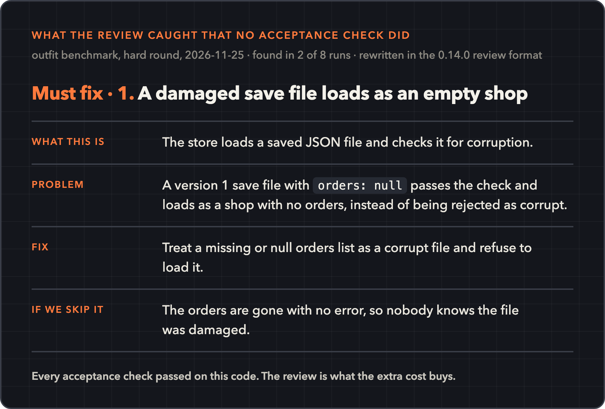
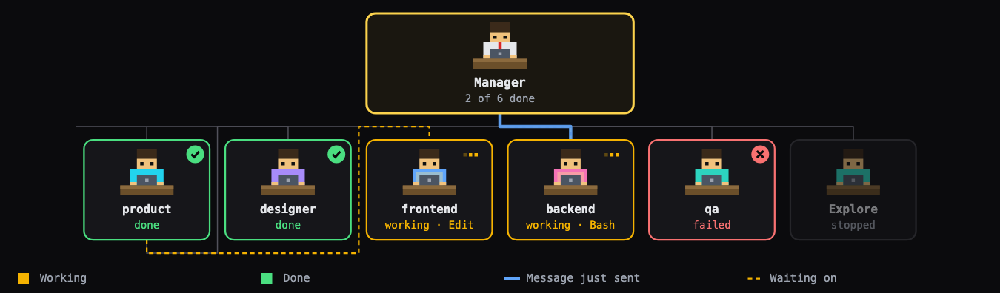

# outfit

**Nine markdown subagents for the whole product loop: brief, design, build, QA, review, local commit.**

[](LICENSE)
[](https://github.com/mategog/outfit/actions/workflows/validate.yml)
[](CHANGELOG.md)

Markdown-only plugin: no hooks, no scripts, no telemetry. Agents never push; every commit stays on your machine. CI fails the build if the plugin ever gains a non-markdown file.

Most coding agents start at "write the code". outfit starts one step earlier and ends one step later: you give it an idea, a **product owner** turns it into a one-page brief you approve, a **designer** specs the screen you approve, **frontend and backend** build it, **QA** tries to break it, **review** reads the diff, and the **manager** hands you a reviewed local commit. It is built for solo developers and small teams who have no product manager, designer or QA engineer on staff.

**A real run, not a mock-up:** "Show each habit's current streak next to its name" on a small habit tracker. About 15 minutes from command to commit (4 of them waiting for the owner's approval), 13/13 tests, QA pass, review approve. One run, on outfit 0.4.0, and it found four bugs in the plugin itself. The brief, design spec, diff and unedited log are in [examples/demo-run](examples/demo-run/).

## Try it in two minutes

In Claude Code, as two separate prompts:

```
/plugin marketplace add mategog/outfit
```
```
/plugin install outfit@outfit
```

Only install outfit from `mategog/outfit` on GitHub. It ships no executables or scripts; a copy that does is not this one.

Start a new Claude Code session, then in your project:

```
/outfit:setup                 # once: writes company/profile.md, which every agent reads
/outfit:build <your idea>     # approve the brief, approve the design, let the team work
```

**Check the result:** open the brief in `company/briefs/`, read the diff, and run `git log` on the `outfit/<feature>` branch. That is all it changed. Stop there; `/outfit:status` shows what is in progress or waiting for you.

Already installed? Third-party marketplaces don't auto-update by default: run `/plugin marketplace update outfit`, then `claude plugin update outfit@outfit`, and start a new session.

## Why use it

- **You stay the owner, and it can show where.** Nothing is built until you approve the brief, and UI isn't coded until you approve the design. The approved scope is frozen: agents are told never to edit it to match what they built. (These gates are instructions the agents follow, not hard blocks; the [plugin reference](plugins/outfit/README.md#what-is-enforced-and-what-isnt) spells out exactly what Claude Code enforces.)
- **It covers the jobs you don't have a person for.** A designer who writes a spec and then critiques the built screen at three widths. A QA tester who uses the product like a user. A reviewer who flags deleted tests, loosened assertions and swallowed errors. Pricing and launch-copy agents when a brief touches money.
- **Your repo is safe from it.** It works on a local `outfit/<feature>` branch, or a git worktree beside your repo if you have uncommitted work. It is told never to push, merge, tag or deploy. You decide what leaves your machine.
- **You can read all of it.** Fifteen markdown files; start with [`manager.md`](plugins/outfit/agents/manager.md), the playbook everything else plugs into. No installer, no background process, no code of its own that makes network calls (the product, marketing and finance agents use web search for research; `/outfit:review-pr` reads GitHub through your own `gh` and `git`). The bar for adding anything is "does a solo builder clearly need this?" ([CONTRIBUTING](CONTRIBUTING.md)).
- **It tells you what it costs and what it did not prove.** See [Numbers](#numbers): it matched a plain session on correctness and cost more; what the extra spend bought is the review.
- **It resumes where it stopped.** Each brief records its status, next step and each repo's branch and baseline commit, so a crash or a new day doesn't lose the build.

**Not for you if** you want one-line scripts (a plain prompt is faster), a push-to-production autopilot, or a guarantee of better code. outfit does not claim better code or faster delivery than a good prompt (it was slower and dearer in its own benchmark); it gives the work a brief, a design, a test run and a second pair of eyes. If the task is already fully specified and backend-only, a plain session may be all you need.

## Numbers

Headless runs on Claude Sonnet 5.5, 2026-11-25: well-specified backend features in a small Node library, hidden acceptance checks written before any run. ([Method and limits](benchmark/README.md).)

| | plain session | feature-dev | outfit |
|---|--:|--:|--:|
| Hidden checks passed, medium features | 160/160 | 160/160 | 160/160 |
| Hidden checks passed, hard features | 146/146 | 146/146 | 146/146 |
| Mean cost, medium / hard | $0.22 / $0.54 | $0.25 / $0.62 | $0.75 / $2.43 |

Same correctness, about 3.5 to 4.5 times the cost. What the extra spend bought: on the hard features the review said "changes needed" in 3 of 8 runs, with defects no acceptance check covered (whether a plain session shares them was not checked).

<p align="center">
  
</p>

Backend only, two runs per arm and task; the product and QA agents were never spawned in these headless runs, so this measured the backend and review agents, not the full team. Model choices were tested the same way, with sample sizes in the [CHANGELOG](CHANGELOG.md).

## How a build runs

```
idea → brief → you approve → plan → design → you approve → build → QA → review → local commit
```

Small briefs (one builder team, no new screen, no money, no new dependency) skip the plan and the designer. The full flow chart, the agent roster and every rule are in the [plugin reference](plugins/outfit/README.md).

## The team

| Agent | Job |
|---|---|
| `product` | Turns your idea into a one-page brief: problem, scope, non-goals, done-checks |
| `manager` | Plans the work, runs the other agents, tracks progress, commits locally |
| `designer` | Writes the spec before any new screen; critiques the built UI afterwards |
| `frontend` | Builds the UI to the spec and checks it in a browser |
| `backend` | Logic, APIs, data, scripts and tests |
| `qa` | Uses the product like a user and tries to break it |
| `review` | Reads the diff for bugs, security holes, cheated tests, needless code |
| `marketing` | Competitor matrix, launch and store copy, customer research |
| `finance` | Pricing, fee comparisons, break-even and scenario spreadsheets (not tax advice) |

You can also call any one directly: "use outfit:finance to compare Paddle and Stripe at €29".

## Two parts, one repo

| | **[Plugin](plugins/outfit/)** | **[Mod: Team pane](mods/outfit-view/)** |
|---|---|---|
| What it is | The nine agents and the `/outfit:build`, `:review-pr`, `:audit`, `:setup`, `:status` and `:help` commands | A live pane next to the chat: who is working, who failed, who is talking to whom |
| Contains | Markdown only | A small TypeScript module (about 780 lines, with tests) |
| Required? | Yes, it is the product | No. outfit works the same without it, and the pane works with any subagents |
| Install | `/plugin install outfit@outfit` | `/plugin install outfit-view@outfit` |
| Needs | Claude Code | Claude Code 2.1.287+ (desktop 2.1.286+) |
| Trust | Reads and writes files, runs commands, only inside the tool limits each agent lists | Mods run inside Claude Code with your permissions, unsandboxed. It makes no network calls and touches no files. Read the source first |
| Read more | [Plugin reference](plugins/outfit/README.md) | [Mod README](mods/outfit-view/README.md) |

The mod is early: its tests and validation pass, but it hasn't yet been watched live with a real build.



*A render of the mod's own drawing code with sample data, not a screenshot of a live build.*

## Go deeper

| Read | For |
|---|---|
| [Plugin reference](plugins/outfit/README.md) | Every agent and model, the full rules, what is enforced and what isn't, the profile options, FAQ, how it compares with superpowers, BMAD and gstack |
| [Mod README](mods/outfit-view/README.md) | What the Team pane shows, what it reads, how to install and turn it off |
| [Benchmark](benchmark/README.md) | The team against a plain session and feature-dev: what it matched, what it cost, what its review caught |
| [Demo run](examples/demo-run/) | A real build end to end: brief, design spec, diff, log, screenshots |
| [Example project files](examples/) | What outfit writes into your repo (`company/`, `design/`) |
| [CHANGELOG](CHANGELOG.md) | Every release, with what was measured and how large the sample was |
| [CONTRIBUTING](CONTRIBUTING.md) | How to change an agent or the mod |

## Repo layout

```
.claude-plugin/marketplace.json   lists both parts for /plugin install
plugins/outfit/                 the plugin: agents/, skills/, README.md
mods/outfit-view/               the mod: hooks/, types/, docs/, README.md
benchmark/                        the team against a plain session, with limits
examples/                         a real demo run and sample project files
```

## License

[MIT](LICENSE) © [Máté Góg](https://github.com/mategog). Questions, bugs and ideas are welcome in [GitHub Issues](https://github.com/mategog/outfit/issues).
