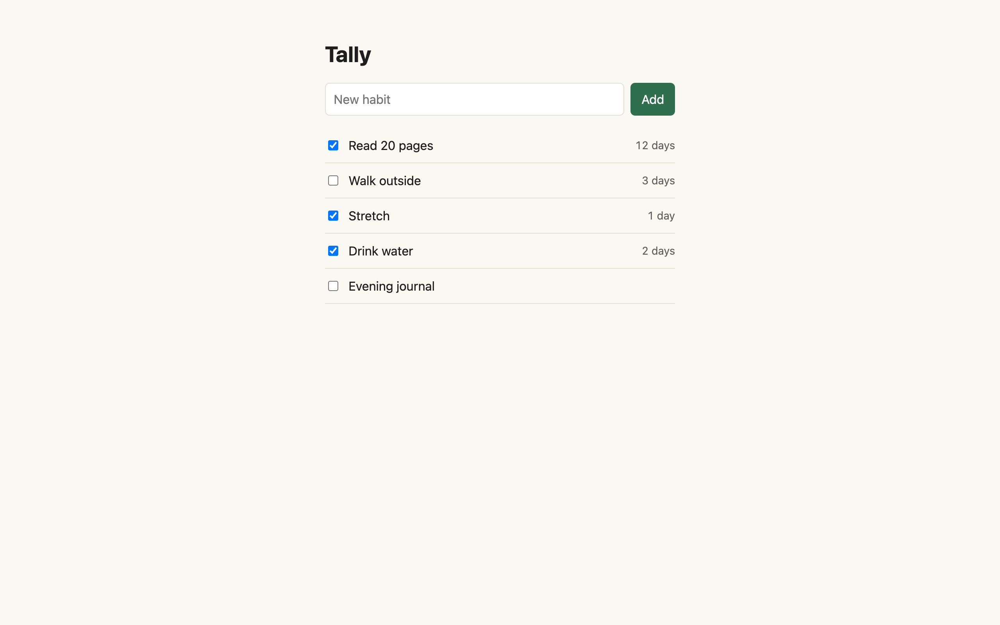
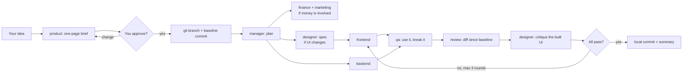

# dev-team — an AI dev team for Claude Code

[](LICENSE)
[](CHANGELOG.md)
[](https://github.com/mategog/dev-team/actions/workflows/validate.yml)

**dev-team is an open-source Claude Code plugin that adds nine specialized subagents — product owner, manager, designer, frontend, backend, QA, code review, marketing and finance — and runs them as one end-to-end workflow:** a one-page brief you approve, then design, build, QA, code review and a local git commit. It's built for solo developers and small teams who want the whole product loop, not just coding.

Markdown only. No hooks, no scripts, no telemetry, and no network calls from the plugin itself (the product, marketing and finance agents use web search for research). 9 agents + 3 commands, about 900 tokens added to each session.

## Quick start

1. Add the marketplace and install the plugin in Claude Code:
   ```
   /plugin marketplace add mategog/dev-team
   /plugin install dev-team@dev-team
   ```
2. Start a new Claude Code session.
3. In your project, run `/dev-team:setup` once — it writes `company/profile.md`, which every agent reads.
4. Run `/dev-team:build <your idea>`, approve the brief, and let the team work. `/dev-team:status` shows progress.

---

## A real run



The first end-to-end `/dev-team:build` on a tiny habit tracker: *"Show each habit's current streak next to its name."* **About 15 minutes** from command to local commit (4 of them waiting for approval), **13/13 tests**, QA `pass`, review `approve`, designer `looks right`. The brief, design spec, code diff and an honest run log — including the plugin bugs it found — are in [examples/demo-run](examples/demo-run/).

## How a build runs



## The team

| Agent | Job | Edits code? | Default model |
|---|---|---|---|
| `product` | Turns your idea into a one-page brief: problem, premise check, scope, non-goals, done-checks | No | sonnet |
| `manager` | Plans the work, runs the teams, logs progress in the brief, grades findings, commits locally at the end | Integration fixes only | inherit |
| `designer` | Writes a spec before any new screen; critiques the built UI at 1440 / 768 / 375 px | No — writes `design/` docs only | inherit |
| `frontend` | Builds UI to the spec, verifies in the browser | Yes | inherit |
| `backend` | Logic, APIs, data, scripts, tests | Yes | inherit |
| `qa` | Uses the product like a user and tries to break it | No | sonnet |
| `review` | Reviews the diff: correctness, cheated tests, security, needless code — reports only findings it's 80%+ sure of | No | inherit |
| `marketing` | Competitor feature matrix, launch and store copy, customer research | No code | sonnet |
| `finance` | Pricing, fee comparisons, break-even and scenario spreadsheets. Not tax advice. | No code | sonnet |

`inherit` uses your session's model; `sonnet` keeps cheaper roles cheap. When the manager, frontend or backend spawn another agent, they name its model: that agent's default, or `sonnet` for mechanical tasks (searches, renames, running tests). Change `model:` in any agent file to suit your plan.

## Commands

| Command | What it does |
|---|---|
| `/dev-team:setup` | Asks a few questions and writes `company/profile.md`: product, brand, values, stack, design system. Every agent reads it first. |
| `/dev-team:build <idea>` | The whole pipeline above. Resumes an unfinished build if there is one. |
| `/dev-team:status` | What's in progress, done, stopped, and waiting on you. |

You can also call any agent directly, e.g. "use dev-team:finance to compare Paddle and Stripe at €29".

## What it keeps in your repo

```
company/
  profile.md            who you are and how you build (read by every agent)
  decisions.md          one line per decision: date · decision · why
  briefs/<feature>.md   frozen approved scope + plan + progress log + status
  marketing/            competitor profiles and feature matrix
  finance/<topic>.xlsx  models with Inputs / Scenarios / Sensitivity / Checks sheets
design/
  <feature>-spec.md     designer → frontend handoff
  <feature>-critique.md designer's review of the built UI
```

Because state lives in the brief (`status:`, `baseline:`, `branch:`, Plan, Progress log), a build interrupted by a crash, a compaction or a new day picks up where it stopped.

## Rules the agents follow

- **You approve the brief before anything is built.** Its scope is then frozen; agents are told never to edit it to match what they built.
- **Git safety.** Stops and asks if your tree is dirty. Works on a local `dev-team/<feature>` branch. Builders never run `git checkout --`, `restore`, `reset --hard`, `clean` or `stash` (they share one folder). Only the manager commits, locally. **Nothing is ever pushed, merged, tagged or deployed** without you.
- **No cheating to green.** Review flags deleted or skipped tests, loosened assertions, regenerated snapshots, swallowed errors, placeholder code, and specs edited to match the build. A run with zero tests is not a pass.
- **Bug fixes start with a failing test.** A check that couldn't have failed proves nothing.
- **Fix loops stop after 3 rounds** and hand the open findings to you.
- **Every claim says what it rests on:** ran it / read it / not verified.
- **No invented numbers** in marketing or finance: every figure is verified (source + date), an estimate, or a labelled assumption.

## What is enforced, and what isn't

Claude Code enforces each agent's **tool list**, and that's all:
- `qa` and `review` can't use Write/Edit — but keep a terminal to run tests, so "never change files" is still an instruction for them.
- `designer` can't Edit or use a terminal, but can Write (for its `design/` docs) — staying in `design/` is an instruction.
- `product`, `marketing` and `finance` can write files (and finance has a terminal for spreadsheets); staying in `company/` is an instruction.

Everything else above — approval first, frozen scope, git rules, 3-round cap, no cheating — is an **instruction** the agents follow, not a hard gate. If you want hard blocks, add your own hooks (e.g. with Anthropic's `hookify` plugin).

## Recommended skills

Agents preload or load these when present. Install them in `~/.claude/skills/` (read each one first — they're third-party):

| Skill | Used by | Source |
|---|---|---|
| `ponytail` | manager, frontend, backend, review | [DietrichGebert/ponytail](https://github.com/DietrichGebert/ponytail) — copy `skills/ponytail` only |
| `interface-design` | designer | [Dammyjay93/interface-design](https://github.com/Dammyjay93/interface-design) |
| `make-interfaces-feel-better` | designer | [jakubkrehel/make-interfaces-feel-better](https://github.com/jakubkrehel/make-interfaces-feel-better) |
| `emil-design-eng` | designer (motion) | [emilkowalski/skills](https://github.com/emilkowalski/skills) |
| `pricing`, `competitor-profiling`, `customer-research` | finance, marketing | [coreyhaines31/marketingskills](https://github.com/coreyhaines31/marketingskills) |
| `owasp-security` | review, backend (security checks) | an OWASP security-review skill of your choice (e.g. from the Claude plugin directory) |
| `frontend-design` | designer (new visual direction) | Anthropic's [frontend-design](https://github.com/anthropics/claude-plugins-official) plugin |
| `audit-xls` | finance | [anthropics/financial-services-plugins](https://github.com/anthropics/financial-services-plugins) — copy `audit-xls/SKILL.md` only |
| `xlsx` | finance | Anthropic's document skills (may appear as `anthropic-skills:xlsx`) |
| `design`, `marketing`, `data` plugins | designer, marketing, finance — optional | Anthropic's knowledge-work plugins |

Without them the agents still work; they just lose that guidance.

## Works with other plugins

- **superpowers** (obra/superpowers): `/dev-team:build` replaces its brainstorming and planning for that run — don't run both on the same feature. Builders may still use its `systematic-debugging` and `verification-before-completion`.
- **Anthropic's code-review / pr-review-toolkit**: fine as an extra review on the branch before you open a PR.

## How it compares

Checked 2026-11-09 by reading each project's files. Stars change; strengths don't much.

| | dev-team | [superpowers](https://github.com/obra/superpowers) | [BMAD-METHOD](https://github.com/bmad-code-org/BMAD-METHOD) | [gstack](https://github.com/garrytan/gstack) | [feature-dev](https://github.com/anthropics/claude-plugins-official) |
|---|---|---|---|---|---|
| Product brief + owner approval | yes | design doc | PRD | yes | clarifying questions |
| UI design spec + critique of built UI | **yes** | — | UX role | design review | — |
| Marketing / pricing roles | **yes** | — | analyst | — | — |
| Resume after interruption | yes (brief state) | yes (progress log) | yes | yes | — |
| Test-first rule | bug fixes only | always (strict) | yes | bug fixes | — |
| Hard enforcement (hooks) | none | session-start hook | none | several | none |
| Deploy / release automation | no (by design) | finish branch | no | yes | no |
| Footprint | 12 agent/skill files, all markdown | large | very large, installer | very large, installer | small |
| Network / telemetry | web search by research agents only | version-reporting logo (can be turned off) | update checks | opt-in telemetry | none |

Pick dev-team if you're a solo builder or a small team who wants the whole product loop — brief, design, code, QA, review, pricing, copy — in a small plugin you can read end to end. Pick superpowers or gstack if you want stricter, hook-enforced engineering discipline and are fine with a bigger footprint.

## FAQ

### What is dev-team?
dev-team is a free, MIT-licensed Claude Code plugin that gives Claude a small product team: nine subagents with separate roles and tool limits, plus `/dev-team:build`, which takes an idea through an approved brief, design, build, QA and code review to a local git commit.

### How do I install a Claude Code plugin from GitHub?
In Claude Code, run `/plugin marketplace add mategog/dev-team`, then `/plugin install dev-team@dev-team`, and start a new session. The same two commands work for any plugin repo that ships a `.claude-plugin/marketplace.json`.

### Does dev-team push code, open PRs or deploy?
No. It works on a local `dev-team/<feature>` branch and the manager makes one local commit at the end. Pushing, merging, tagging, publishing and deploying are always left to you.

### Is it for solo developers or teams?
It's designed for solo builders and small teams who don't have a designer, QA engineer, product manager or pricing person — the agents fill those roles. Larger teams can use individual agents, such as `dev-team:review` or `dev-team:qa`, inside their own process.

### How much does it cost to run?
The plugin is free. Runs use your own Claude plan or API usage. Cheaper roles (product, QA, marketing, finance) default to Sonnet; the rest inherit your session's model, and helpers doing mechanical work run on Sonnet. You can change `model:` in any agent file.

### Does it work with superpowers or other Claude Code plugins?
Yes. `/dev-team:build` replaces superpowers' brainstorming and planning for that feature, so don't run both on the same feature; builders can still use its debugging and verification skills. Anthropic's code-review plugins work as an extra review on the branch.

### Do I need the recommended skills?
No. Without them the agents still work; they lose the extra guidance those skills add (for example ponytail's "smallest change" rules or the pricing frameworks).

### What happens if a build is interrupted?
Each brief stores its status, starting commit, branch, plan and progress log. Run `/dev-team:build` again and it offers to resume where it stopped.

## Contributing

See [CONTRIBUTING.md](CONTRIBUTING.md). Changes to agent behaviour need a line in [CHANGELOG.md](CHANGELOG.md) and a version bump in both `.claude-plugin/*.json` files — without the bump, installed copies don't update.

## License

[MIT](LICENSE) © [Máté Góg](https://github.com/mategog). Issues and ideas welcome in [GitHub Issues](https://github.com/mategog/dev-team/issues).
