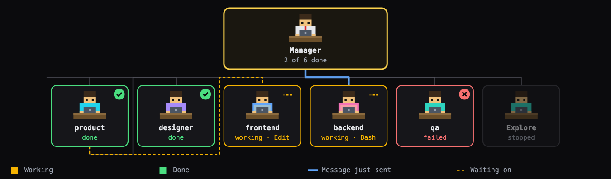
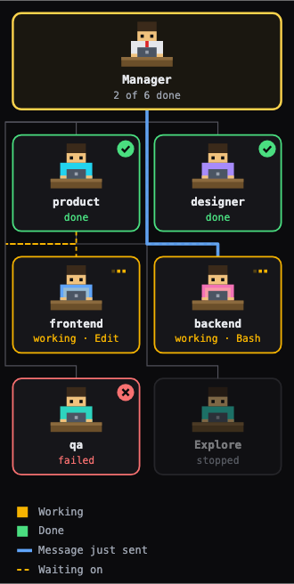

# dev-team-view

A live **Team** pane for the [dev-team](https://github.com/mategog/dev-team) plugin, drawn next to the chat in the Claude Code desktop app. It shows a manager desk and one desk per subagent: who is working (and the last tool it used), who is done, failed or stopped, a line between agents for the latest message, and a feed of the last messages between agents. In a terminal, where there is no SVG, it shows a plain list of the same.

It works with any subagents, not just dev-team's. It costs the model no tokens: it adds nothing to the prompt and registers no tool. Type `/team` to open the pane. If you close it, a **Team ▸** button appears above the prompt to bring it back.

## What it looks like

The same 6 agents in a wide pane, where the desks sit in one row (product and designer done, frontend and backend working, qa failed, one agent stopped; blue line = the latest message):

And in a narrow pane, where the desks stack in two columns:

These are renders of the mod's own drawing code with sample data, not screenshots of a live build. The size is fixed (about 16px text, a desk about 170px wide), so wider panes fit more desks per row instead of drawing them bigger.

## Install

In a terminal session: `/plugin install dev-team-view@dev-team`

In the desktop app: click + next to the prompt box, then Plugins, add the marketplace `mategog/dev-team`, then Add plugin `dev-team-view`.

Needs a Claude Code version that supports mods (2.1.287 or newer; desktop app 2.1.286 or newer).

## Status

Early. `claude plugin validate` passes and `claude plugin test` runs 6 tests, but it hasn't yet been watched live with a real build, so the SVG animations and hover tooltips are unconfirmed in the desktop pane.

## Layout

- `hooks/register.tsx`: collects agent start, report, tool and message events and draws the pane.
- `hooks/hive.ts`: draws the desks as an SVG string (internal file name, nothing to do with bees).
- `types/index.d.ts`: the shape of the state it keeps.
