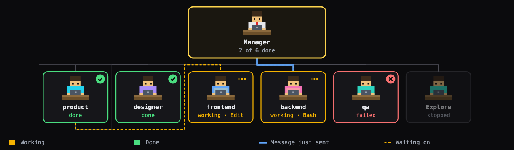
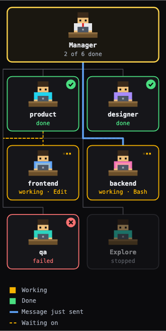

# outfit-view: see your agent team work

> Part of [outfit](../../README.md). This is the optional **mod**. The [plugin](../../plugins/outfit/README.md) is the team itself, and it works the same without this.

A live **Team** pane next to your chat in the Claude Code desktop app: a manager desk and one desk per subagent. You see who is working (and the last tool they used), who is done, failed or stopped, a line between agents for the latest message, and a feed of the last messages between them. In a terminal, where there is no SVG, you get a plain list of the same.



## Why use it

- **You see who is talking to whom.** The desktop app's Background tasks pane lists which subagents are running, and Claude Flightdeck (checked 2026-11-25) shows per-agent cost, context and recent tool calls. Neither's documentation mentions what this one shows: the messages between agents, and which agent failed or was stopped, as an office you can read at a glance.
- **It costs nothing in tokens.** It adds nothing to the prompt and registers no tool for the model. It only listens to events Claude Code already emits.
- **It works with any subagents**, not just outfit's. Use it with your own agents too.
- **You see what each agent's tests actually did.** When a subagent runs a test command (`npm test`, `pytest`, `claude plugin test` and other common runners), its desk shows the result, such as "✓ 13 tests" or "✗ 2 failed". It switches to "tests stale" once that agent edits a file afterwards. You can compare that with what the agent reports.
- **You see what the team run cost.** The pane's top line shows the session's spend since the first agent started, such as "Team · $1.84 since first agent". It is Claude Code's own cost estimate, not a bill, and nothing is shown where Claude Code keeps no cost.
- **Copy** puts the run on your clipboard as Markdown: each agent's role, task, status, duration and tests, plus the last messages.
- **It stays out of the way.** The pane opens by itself when the first agent of a session starts, and `/team` opens it at any time. Close it and it stays closed for that session, with a **Team ▸** button above the prompt to bring it back.

## Install

In a terminal session:

```
/plugin marketplace add mategog/outfit
/plugin install outfit-view@outfit
```

In the desktop app, where `/plugin` doesn't run: click + next to the prompt box, then Plugins, add the marketplace `mategog/outfit` if it isn't there, then Add plugin `outfit-view`.

Needs a Claude Code version that supports mods: 2.1.287 or newer, desktop app 2.1.286 or newer.

## What it looks like

In a narrow pane the desks stack in two columns:



Both images are renders of the mod's own drawing code with sample data (product and designer done, frontend and backend working, qa failed, one agent stopped; blue line = the latest message), not screenshots of a live build. The size is fixed (about 16px text, a desk about 170px wide), so wider panes fit more desks per row instead of drawing them bigger.

## What it reads and keeps

- **Mods run inside Claude Code with your account's permissions and are not sandboxed.** That is how Claude Code mods work, so read the source before you install any mod. This one is about 780 lines in [`hooks/`](hooks/) and [`types/`](types/), tests included.
- It listens for agent start and report events, tool calls and messages between agents. It keeps the last 60 agents and the last 100 messages (each cut to 300 characters) in Claude Code's own state, to draw the pane.
- For a subagent's Bash call it checks whether the command is a test run. If so, it reads the output only for the pass and fail counts, and keeps just those and pass/fail/stale. It doesn't keep the command or the output.
- It reads the session's cost from Claude Code (`$.session.usage()`) and keeps one number: the cost when the first agent started.
- It writes to the clipboard only when you press **Copy**.
- It makes no network calls and reads and writes no files; there is no `fetch`, `fs` or process call anywhere in the source.
- It adds nothing to the prompt and registers one command, `/team`.

## Status

Early. `claude plugin validate` passes and `claude plugin test` runs 15 tests, but it hasn't yet been watched live with a real build. Still unconfirmed in the desktop app: the SVG animations, the hover tooltips, the automatic open at the first agent, the Copy button, and the cost figure on your plan. The images above predate the tests row on each desk.

## Source map

- [`hooks/register.tsx`](hooks/register.tsx): collects agent start, report, tool and message events and draws the pane.
- [`hooks/hive.ts`](hooks/hive.ts): draws the desks as an SVG string (internal file name, nothing to do with bees).
- [`types/index.d.ts`](types/index.d.ts): the shape of the state it keeps.
- Tests sit next to the code (`*.test.ts`, `*.test.tsx`).
