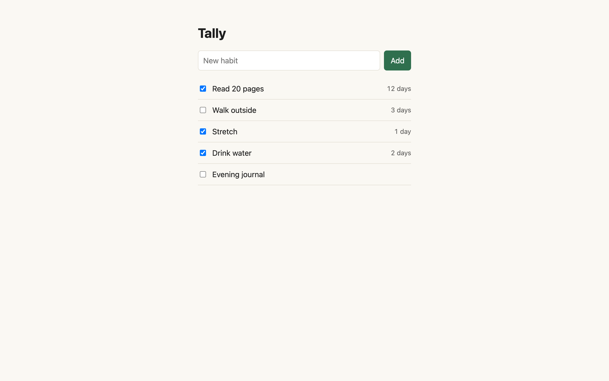
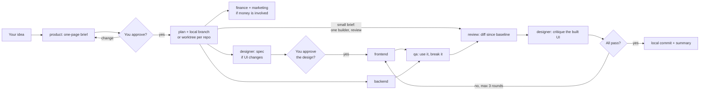

# outfit: the plugin

> Part of [outfit](../../README.md). This page is the full reference for the plugin; the [repo README](../../README.md) is the short pitch, and the optional live Team pane is a separate [mod](../../mods/outfit-view/README.md).

[](../../LICENSE)
[](../../CHANGELOG.md)
[](https://github.com/mategog/outfit/actions/workflows/validate.yml)

**outfit is an open-source Claude Code plugin that adds nine specialized subagents — product owner, manager, designer, frontend, backend, QA, code review, marketing and finance — and runs them as one end-to-end workflow:** a one-page brief you approve, then design, build, QA, code review and a local git commit. It's built for solo developers and small teams who want the whole product loop, not just coding.

Markdown only. No hooks, no scripts, no telemetry, and no code of its own that makes network calls (the product, marketing and finance agents use web search for research; `/outfit:review-pr` reads GitHub through your own `gh` and `git`). 9 agents + 6 commands, about 900 tokens added to each session. The optional team view is a separate [mod](../../mods/outfit-view/README.md), not part of the plugin.

## Quick start

1. Add the marketplace and install the plugin in Claude Code:
   ```
   /plugin marketplace add mategog/outfit
   ```
   then, as a separate prompt:
   ```
   /plugin install outfit@outfit
   ```
   Only install outfit from `mategog/outfit` on GitHub.
2. Start a new Claude Code session.
3. In your project, run `/outfit:setup` once — it writes `company/profile.md`, which every agent reads.
4. Run `/outfit:build <your idea>`, approve the brief, and let the team work. `/outfit:status` shows progress.

---

## A real run



The first end-to-end `/outfit:build` on a tiny habit tracker: *"Show each habit's current streak next to its name."* **About 15 minutes** from command to local commit (4 of them waiting for approval), **13/13 tests**, QA `pass`, review `approve`, designer `looks right`. The brief, design spec, code diff and an honest run log — including the plugin bugs it found — are in [examples/demo-run](../../examples/demo-run/).

## How a build runs



## The team

| Agent | Job | Edits code? | Default model |
|---|---|---|---|
| `product` | Turns your idea into a one-page brief: problem, premise check, scope, non-goals, done-checks | No | sonnet |
| `manager` | Plans the work, runs the teams, logs progress, grades findings, commits locally slice by slice. `/outfit:build` runs its playbook in your main session, so it can stop at your gates and wait for every report. | Integration fixes only | inherit |
| `designer` | Writes a spec before any new screen; critiques the built UI at 1440 / 768 / 375 px | No — writes `design/` docs only | sonnet |
| `frontend` | Builds UI to the spec, verifies in the browser | Yes | sonnet |
| `backend` | Logic, APIs, data, scripts, tests | Yes | sonnet |
| `qa` | Uses the product like a user and tries to break it | No | sonnet |
| `review` | Reviews the diff: correctness, cheated tests, security, needless code — reports only findings it's 80%+ sure of | No | sonnet |
| `marketing` | Competitor feature matrix, launch and store copy, customer research | No code | sonnet |
| `finance` | Pricing, fee comparisons, break-even and scenario spreadsheets. Not tax advice. | No code | sonnet |

`inherit` uses your session's model; `sonnet` keeps cheaper roles cheap. When the manager spawns an agent, it names its model: that agent's default, `haiku` for mechanical tasks (searches, renames, running tests, generating test data from a clear recipe) and for QA on a brief with no screen, or a stronger model for a hard task or a fix that already failed a round. When a brief is risky (it matches one of the six triggers in `agents/manager.md`: secrets, permissions, money or stored value, personal data, deleting or migrating data, acting outside the app), the final review also runs on the strongest model you have, next to the default-model review. Change `model:` in any agent file to suit your plan. Want a stricter reviewer or a more opinionated designer? Set `model: inherit` in `agents/review.md` or `agents/designer.md`. The same line in `agents/frontend.md` and `agents/backend.md` puts the builders back on your session's model.

Every agent lists the tools it uses (`tools:` in its file) instead of inheriting all of them, so a spawn doesn't carry every tool and MCP server you have installed. `frontend`, `qa` and `designer` get Claude's built-in browser, the Chrome extension and Playwright. If a role needs something that isn't listed (a database server for `backend`, another browser server for the three browser roles), add its name there, e.g. `mcp__yourserver__*`.

## Optional: team view

A separate mod, [`outfit-view`](../../mods/outfit-view/README.md), adds a live **Team** pane next to the chat: who is working, who is done or failed, and the messages between agents. It is not part of this plugin and the plugin works the same without it.

## Commands

| Command | What it does |
|---|---|
| `/outfit:setup` | Asks a few questions and writes `company/profile.md`: product, brand, values, stack, design system. Every agent reads it first. |
| `/outfit:build <idea>` | The whole pipeline above. Resumes an unfinished build if there is one. |
| `/outfit:status` | What's in progress, done, stopped, and waiting on you. |
| `/outfit:review-pr <PR number, URL or branch>` | Reviews someone else's PR in a separate worktree and reports: verdict, graded findings, promises met or missing, a review text to paste. Never posts or edits. |
| `/outfit:audit [folder]` | Reviews the whole repo (or one folder) and ranks what it finds: bugs, security, what breaks at your expected load, risky code without tests, code to cut. Numbered, so you can say "fix 2 and 5" and get briefs. Changes nothing. |
| `/outfit:help` | One-screen reference: commands, profile options, brief statuses. |

**Engineer mode.** `/outfit:setup` first asks whether you own the product or work on an existing codebase. Engineers skip the brand, audience and values questions: setup scans the repo and writes a `## Codebase` section (layout, how to run and test, conventions, commit style, fragile areas, expected load, and a `Shared code to reuse:` list builders check before writing anything new) and an `Only:` line under `## Teams in use` naming product, manager, designer (only when there is a UI), frontend, backend, qa and review. Only an `Only:` line restricts: product and manager skip off-list teams, while a direct call ("use outfit:finance ...") is not blocked. Existing profiles are unchanged.

You can also call any agent directly, e.g. "use outfit:finance to compare Paddle and Stripe at €29".

## What it keeps in your repo

```
company/
  profile.md            who you are and how you build (read by every agent)
  decisions.md          one line per decision: date · decision · why
  briefs/<feature>.md   status, size, next step, repos; frozen approved scope; owner checks
  briefs/<feature>/     plan.md and log.md (one short line per step)
  marketing/            competitor profiles and feature matrix
  finance/<topic>.xlsx  models with Inputs / Scenarios / Sensitivity / Checks sheets
design/
  <feature>-spec.md     designer → frontend handoff
  <feature>-critique.md designer's review of the built UI
```

Brief statuses: `draft` → `approved` → `building` → `testing` → `done`, plus `waiting-owner`, `parked`, `stopped` and `superseded`; `next:` says in one line what happens next and who does it. Each repo the build touches is listed with its path (repo or worktree), branch and baseline commit, so a build interrupted by a crash, a compaction or a new day picks up where it stopped — including builds that span several repos.

**Small briefs** (one builder team, no new screen, no money, no new dependency) skip the plan and the designer: one builder, then review, plus QA when users see the change.

## Rules the agents follow

- **You approve the brief before anything is built.** Its scope is then frozen; agents are told never to edit it to match what they built.
- **You approve the design before UI code is written**, unless `company/profile.md` turns that gate off.
- **You review the build one slice at a time** (about 500 changed lines each, with a review map), unless `company/profile.md` turns that gate off.
- **Owner checks stay yours.** The brief lists what only you can verify (real device, real accounts, payments); agents never fake them, and the summary lists the open ones before offering to push or merge.
- **Git safety.** Never touches your uncommitted work: a repo that's dirty or busy with another build gets a git worktree beside it. Works on a local `outfit/<feature>` branch. Builders never run `git checkout --`, `restore`, `reset --hard`, `clean` or `stash` (they share one folder). Only the manager commits, locally. **Nothing is ever pushed, merged, tagged or deployed** without you.
- **No cheating to green.** Review flags deleted or skipped tests, loosened assertions, regenerated snapshots, swallowed errors, placeholder code, and specs edited to match the build. A run with zero tests is not a pass.
- **Bug fixes start with a failing test.** A check that couldn't have failed proves nothing.
- **Fix loops stop after 3 rounds** and hand the open findings to you.
- **Every claim says what it rests on:** ran it / read it / not verified.
- **Findings you can act on.** Review findings are numbered and written in plain English (what this is, the problem, the fix, what happens if we skip it), so you can answer "fix 2 and 5".
- **Shortcuts are marked, not hidden.** A deliberate shortcut gets a `shortcut: <the limit>, <when to upgrade>` comment; review treats it as a decision unless your expected load crosses it, and `/outfit:status` counts them.
- **No invented numbers** in marketing or finance: every figure is verified (source + date), an estimate, or a labelled assumption.

## What is enforced, and what isn't

Claude Code enforces each agent's **tool list**, and that's all:
- `qa` and `review` can't use Write/Edit — but keep a terminal to run tests, so "never change files" is still an instruction for them.
- `designer` can't Edit or use a terminal, but can Write (for its `design/` docs) — staying in `design/` is an instruction.
- `product`, `marketing` and `finance` can write files (and finance has a terminal for spreadsheets); staying in `company/` is an instruction.

Everything else above — approval and design gates, frozen scope, git rules, 3-round cap, no cheating — is an **instruction** the agents follow, not a hard gate. If you want hard blocks, add your own hooks (e.g. with Anthropic's `hookify` plugin).

## Recommended skills

Agents preload or load these when present. Install them in `~/.claude/skills/` (read each one first — they're third-party):

| Skill | Used by | Source |
|---|---|---|
| `ponytail` | manager, frontend, backend, review | [DietrichGebert/ponytail](https://github.com/DietrichGebert/ponytail) — copy `skills/ponytail` only |
| `interface-design` | designer | [Dammyjay93/interface-design](https://github.com/Dammyjay93/interface-design) |
| `make-interfaces-feel-better` | designer | [jakubkrehel/make-interfaces-feel-better](https://github.com/jakubkrehel/make-interfaces-feel-better) |
| `emil-design-eng` | designer (motion) | [emilkowalski/skills](https://github.com/emilkowalski/skills) |
| `pricing`, `competitor-profiling`, `customer-research` | finance, marketing | [coreyhaines31/marketingskills](https://github.com/coreyhaines31/marketingskills) |
| `owasp-security` | review, backend (security checks) | an OWASP security-review skill of your choice (e.g. from the Claude plugin directory) |
| `frontend-design` | designer (new visual direction) | Anthropic's [frontend-design](https://github.com/anthropics/claude-plugins-official) plugin |
| `audit-xls` | finance | [anthropics/financial-services-plugins](https://github.com/anthropics/financial-services-plugins) — copy `audit-xls/SKILL.md` only |
| `xlsx` | finance | Anthropic's document skills (may appear as `anthropic-skills:xlsx`) |
| `design`, `marketing`, `data` plugins | designer, marketing, finance — optional | Anthropic's knowledge-work plugins |

Without them the agents still work; they just lose that guidance.

## Works with other plugins

- **superpowers** (obra/superpowers): `/outfit:build` replaces its brainstorming and planning for that run — don't run both on the same feature. Builders may still use its `systematic-debugging` and `verification-before-completion`.
- **Anthropic's code-review / pr-review-toolkit**: fine as an extra review on the branch before you open a PR.

## When to use it, and when not to

We measured it ([method and numbers](../../benchmark/README.md)): five medium backend features and two large cross-cutting ones, each with its rules written down, run on Claude Sonnet 5.5 in a plain session, with Anthropic's feature-dev plugin and with outfit. Every arm passed every hidden acceptance check (160 on the medium features for each of the three main arms, 146 on the large ones). outfit cost about 3.5x as much on the medium features ($0.75 against $0.22) and about 4.5x on the large ones ($2.43 against $0.54), and took 3.5 to 5.5 times as long. In these headless runs the product and QA agents were never spawned (the main session wrote the brief itself), so what was measured is the backend and review agents, not the full team.

So **if you already know exactly what to build and it is backend work with written rules, a single session is enough.** What the team bought in those runs was review: its reviewers found real defects that all the acceptance checks missed (a damaged file that loaded as an empty shop; a store that could be saved but never loaded back), and its code was judged cleaner than a bare session's on the large tasks. Feature-dev's prompt got cleaner code than the team at a third to a quarter of the cost, which is the most useful thing we learned about our own builders.

Use outfit when the work is **not yet specified** (a one-line idea that needs a brief), has a **screen** (design spec, built UI critique, browser QA), touches **money, secrets, permissions, personal data, deletes or migrates data, or acts outside the app** (stronger final review, owner gates), or you want a **written trail** (brief, plan, log, one commit per slice). We did not benchmark those cases, so treat that guidance as design intent, not a measured result. Skip it for quick fixes and small, fully specified features.

## How it compares

Checked 2026-11-09 by reading each project's files. Stars change; strengths don't much.

| | outfit | [superpowers](https://github.com/obra/superpowers) | [BMAD-METHOD](https://github.com/bmad-code-org/BMAD-METHOD) | [gstack](https://github.com/garrytan/gstack) | [feature-dev](https://github.com/anthropics/claude-plugins-official) |
|---|---|---|---|---|---|
| Product brief + owner approval | yes | design doc | PRD | yes | clarifying questions |
| UI design spec + critique of built UI | **yes** | — | UX role | design review | — |
| Marketing / pricing roles | **yes** | — | analyst | — | — |
| Resume after interruption | yes (brief state) | yes (progress log) | yes | yes | — |
| Test-first rule | bug fixes only | always (strict) | yes | bug fixes | — |
| Hard enforcement (hooks) | none | session-start hook | none | several | none |
| Deploy / release automation | no (by design) | finish branch | no | yes | no |
| Footprint | 15 agent/skill files, all markdown | large | very large, installer | very large, installer | small |
| Network / telemetry | web search by research agents; `review-pr` uses your own `gh` and `git` | version-reporting logo (can be turned off) | update checks | opt-in telemetry | none |

Pick outfit if you're a solo builder or a small team who wants the whole product loop — brief, design, code, QA, review, pricing, copy — in a small plugin you can read end to end. Pick superpowers or gstack if you want stricter, hook-enforced engineering discipline and are fine with a bigger footprint.

## FAQ

### What is outfit?
outfit is a free, MIT-licensed Claude Code plugin that gives Claude a small product team: nine subagents with separate roles and tool limits, plus `/outfit:build`, which takes an idea through an approved brief, design, build, QA and code review to a local git commit.

### How do I install a Claude Code plugin from GitHub?
In Claude Code, run `/plugin marketplace add mategog/outfit`, then `/plugin install outfit@outfit`, and start a new session. The same two commands work for any plugin repo that ships a `.claude-plugin/marketplace.json`.

### Does outfit push code, open PRs or deploy?
No. It works on a local `outfit/<feature>` branch (or a worktree, if your repo has uncommitted work) and makes one local commit per reviewed slice. Pushing, merging, tagging, publishing and deploying are always left to you.

### Is it for solo developers or teams?
It's designed for solo builders and small teams who don't have a designer, QA engineer, product manager or pricing person — the agents fill those roles. Larger teams can use individual agents, such as `outfit:review` or `outfit:qa`, inside their own process.

### How much does it cost to run?
The plugin is free. Runs use your own Claude plan or API usage. Every agent defaults to Sonnet except the manager, which is your own session; mechanical helper tasks, per-slice reviews (two in parallel for a one-slice brief that isn't risky; a Sonnet review of the whole diff follows a multi-slice brief) and QA on briefs with no screen run on Haiku, and the manager can name a stronger model for a hard task. Risky briefs (the six triggers in `agents/manager.md`) also get a final review on the strongest model you have (about $0.50–0.70 on Opus, against about $0.20 on Sonnet), next to the Sonnet one. You can change `model:` in any agent file.

### How do I tune it to my project?
Add optional sections to `company/profile.md` (`/outfit:setup` asks for them):
- `## Gates`: `Owner reviews each slice: yes`, `risky only` or `no`.
- `## Teams in use`: `Only: product, manager, backend, qa, review` limits the pipeline to those teams; anything else means all.
- `## Models`: one line per role, e.g. `builders: opus`, `slice reviews: sonnet`, `qa: haiku`, `final review: opus`. Unlisted roles keep the defaults. This survives plugin updates, unlike editing the agent files.
- `## Budget`: `stop above $5 per brief`. The manager keeps a running estimate from each agent's token count (blended rates fitted on 94 runs on one machine, not list prices; a single agent's figure can be off by half and a build's total by about a quarter, and short runs come out up to twice too high, so it errs toward stopping early) and stops to ask before the next agent once it's over. The final report ends with a cost line, labelled an estimate.
- `company/preferences.md`: up to 20 lines of ways you want things done. The manager reads it first, and offers to add a line when you correct the same thing twice (it writes only after you say yes).
- Each brief carries `risk: low | normal | high`, set by the product agent with the trigger that fired; you confirm or correct it when you approve the brief, and the log records which. `high` briefs get the strongest-model final review and a stop after each slice if your gate says `risky only`.

### Does it work with superpowers or other Claude Code plugins?
Yes. `/outfit:build` replaces superpowers' brainstorming and planning for that feature, so don't run both on the same feature; builders can still use its debugging and verification skills. Anthropic's code-review plugins work as an extra review on the branch.

### Do I need the recommended skills?
No. Without them the agents still work; they lose the extra guidance those skills add (for example ponytail's "smallest change" rules or the pricing frameworks).

### How do I review someone else's PR?
Run `/outfit:review-pr <number, URL or branch>`: the team's review in a separate worktree, report only, nothing posted to GitHub. Compare with the built-in `/code-review`, which is not tied to your profile or the team's risk rules.

### What happens if a build is interrupted?
Each brief stores its status, next step, and each repo's branch and starting commit; its plan and log sit beside it. Run `/outfit:build` again and it offers to resume where it stopped.

## Contributing

See [CONTRIBUTING.md](../../CONTRIBUTING.md). Changes to agent behaviour need a line in [CHANGELOG.md](../../CHANGELOG.md) and a version bump in both `plugins/outfit/.claude-plugin/plugin.json` and `.claude-plugin/marketplace.json` — without the bump, installed copies don't update.

## License

[MIT](../../LICENSE) © [Máté Góg](https://github.com/mategog). Issues and ideas welcome in [GitHub Issues](https://github.com/mategog/outfit/issues).
